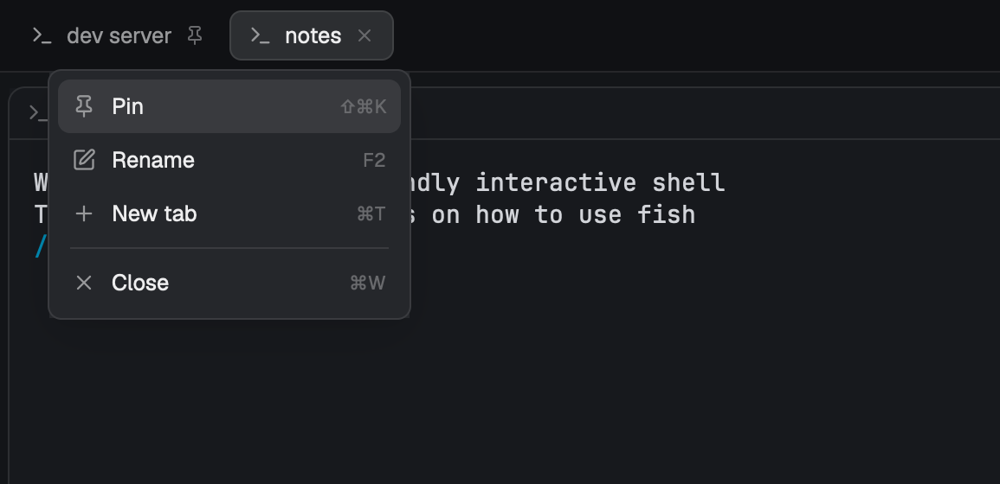

# Tab Pin

A tab bar for [Herdr](https://herdr.dev) that can pin tabs. It is Herdr's own tab bar with one more feature.

## What it does

- Right-click a tab and select **Pin**. The tab moves to the front of the bar and shows a pin icon.
- A pinned tab has no close button. When you press cmd-w on a pinned tab, a toast tells you that the tab is pinned. The toast action unpins the tab and closes it.
- Pins stay after a restart and after a layout switch.
- If you also install [space-welcome](https://github.com/malitov/herdr-space-welcome), a space does not close when you close its last tab. The space shows a welcome page instead.

## Install

1. Copy `mods/tab-pin/` to `~/.config/herdr-app/mods/`.
2. In your layout file, set the content of the tab block to `{ "mod": "tab-pin" }`.
3. Merge `keys.json` into `~/.config/herdr-app/keys.json`. If your layout has a `layout:<name>` section that binds cmd-w, change that key too. The layout section wins over `global`.
4. Run `herdr-app check ~/.config/herdr-app/mods/tab-pin`.

The mod runs one program at start: `test -d ~/.config/herdr-app/mods/space-welcome`. It does not connect to the network.

## Keys

| Key | Action |
|---|---|
| cmd-w | Close the shown tab. A pinned tab does not close. |
| cmd-shift-k | Pin or unpin the shown tab. |

## Build it yourself

[RECIPE.md](RECIPE.md) describes the mod in full. An agent can build the mod from the recipe in an empty folder.
