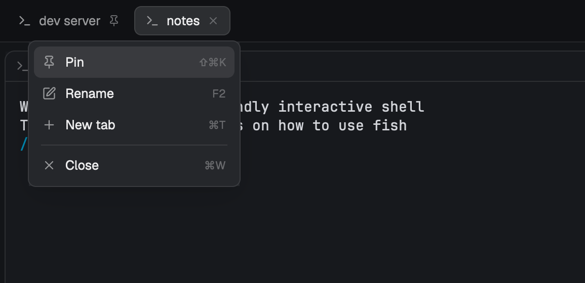

# Tab Pin

Herdr's own tab bar, plus pinning. Right-click a tab and choose **Pin**: the tab jumps to the front of
the bar, shows a small pin after its name and loses its ×. A pinned tab can't be closed by accident:
cmd-w (or the menu's Close) shows a toast "Tab is pinned · Unpin it to close it" whose action unpins
and closes it. Pins survive restarts and layout switches.

## What you see

One horizontal bar, 30px tall in the shipped layout (the block's own height), background `chrome`,
1px `border` line at the bottom, padding 10px (on macOS with `titlebar: "none"` the left padding makes
room for the traffic lights, as Herdr's `tabs` does).

- **Tabs**, left, scrolling sideways: each a pill 29px tall, radius 7, padding 0 10px, gap 7px, text
  12.8px. Shown tab: `raised` background, 1px `border`, `foreground` text; others: `chrome` background
  and border, `muted` text; hover `hover`. In order: the program icon (14px), the name (max 170px,
  truncated; ` Z` when zoomed), **a 12px pin icon in `dim` when pinned**, a spinning 12px spinner in
  `working` while an agent works, a 6px dot in `blocked` / `done` color for those statuses, and on the
  shown tab only, unless pinned, a 12px × in `dim`.
- **Right side**: `+` (26px square button, opens Herdr's `new-menu` popup 250×512), then **Files** and
  **Changes** toggles (shown per shared `workspace.panels`, default both), then window buttons where the
  system draws none.
- **Tab menu** (right-click a tab): a popup 210×176, `popover` background, 5px padding, text 12.8px.
  Rows 31px, radius 7, 14px icon in `muted`, label, the bound key in 11px `dim` on the right, written the platform's way (`cmd-shift-k` is ⇧⌘K on macOS, Super+Shift+K elsewhere, as Herdr's `new-menu` does):
  Pin / Unpin (pin / pin-off icon), Rename, Copy Tab ID (copy icon: copies `Herdr app tab <id>, terminals t3c (read: hc read t3c; type: hc send t3c "...")` so an agent can reach it, and notifies), New tab, a 1px `border` line, Close.

## How it behaves

- Agent status on a tab: working = spinner, blocked / done = colored dot, idle = nothing.
- Click a tab: select it. Double-click: rename. Drag one tab onto another: move it there. Mouse wheel
  or touchpad swipe over the bar: previous / next tab (one per notch; a swipe moves a tab per 60px, at
  most one per 100ms). The shown tab scrolls into view.
- **Pin / Unpin** (menu, or key `tab-pin.pin` for the shown tab) toggles the tab's id in shared
  `"tab-pin.pinned"`. Ids of tabs that no longer exist are dropped on every change.
- **Pinned first**: in the shown space, pinned tabs are kept before unpinned ones, in their current
  relative order. When the order is wrong (just pinned, a drag, a new tab) the bar moves the first
  misplaced tab with `tab.move`, at most once per 300ms; the next render fixes the next one. So
  `tab.next` / `tab.prev` follow the same order.
- **Close** (×, menu, key `tab-pin.close`): pinned → toast (`notify`, pin icon) with action
  `tab-pin.unpin-close`; the tab's id waits in shared `"tab-pin.unpinclose"`, and the action unpins it
  and closes it. Unpinned with an agent that is `working` or `blocked` in the tab → Herdr's `confirm` dialog ("Close tab …?", "<agent> is still running in it. Closing ends it."), which runs `tab.close {id, confirmed: true}`. Otherwise plain `tab.close {id}` (Herdr asks before a space's last tab goes).
- Files / Changes: open and close the layout's `panel` column on that child of `panel-body`;
  remembered per space in the mod's `localStorage`.

## Built from

- One mod, `mods/tab-pin/`, made with `herdr-app do mod.clone '{"name":"tabs","as":"tab-pin"}'` from
  Herdr's shipped `tabs` (0.1.16), then extended. `mod.json`: `{ "place": "none", "title": "Tabs (pinnable)" }`.
  A layout uses it as its tab bar: the tabs block's `"content": { "mod": "tab-pin" }`.
- The same mod draws its own right-click menu: it opens itself as an overlay,
  `openOverlay({ mod: "tab-pin", kind: "popup", width: 210, height: 145, props: { menu: { id, space } } })`,
  and `render()` draws the menu when `props().menu` is set (a focus handle for ↑/↓, Enter, Esc).
- Keys arrive through `nextCommand()`: `close`, `pin`, `unpin-close`.
- `herdr` used: `spaces`, `panes`, `run`, `openOverlay`, `closeOverlay`, `theme`, `window`, `shared`,
  `setShared`, `layout`, `settings`, `props`, `nextCommand`, `notify`, `keys`, `checking`.
  Commands: `tab.select`, `tab.rename`, `tab.move`, `tab.new`, `tab.close`, `tab.prev`,
  `tab.next`, `layout.select`, `layout.show`, `layout.hide`, `window.*`.
- Art (copied into the mod, lucide, tinted): `pin.svg`, `pin-off.svg`, `square-pen.svg`, `plus.svg`,
  `close.svg` (also the menu's Close), `spinner.svg`, and Herdr's Windows buttons `win-*.svg`. It also shows the
  shipped `mods/files/file.svg` and `mods/changes/changes.svg`.
- `keys.json`: `"cmd-w": "tab-pin.close"`, `"cmd-shift-k": "tab-pin.pin"` in `global`. If the layout has
  its own `layout:<name>` section binding cmd-w, set it there too (it wins over global).

## Watch out

- Herdr's shipped `menu` (the default tab right-click) can't take new items, hence the mod's own menu.
- `<mod>.<command>` keys reach only a shown copy: the keys do nothing in a layout whose tab bar isn't
  `tab-pin`.
- Pinned-first uses real `tab.move`s, one per render, throttled; without the throttle it loops while
  the previous move hasn't landed.
- Don't run side effects under `checking()`: `herdr-app check` renders with empty state.
- The pinned toast's action is a mod command with no args, hence the id in shared state.
- The Files / Changes toggles assume the layout has `panel` and `panel-body` nodes, as Herdr's `main` does.

## Done when

- `herdr-app check ~/.config/herdr-app/mods/tab-pin` passes.
- With the layout's tabs block set to `tab-pin`: Pin a second tab → it moves to the front and shows a pin;
  its × is gone.
- cmd-w on the pinned tab → toast "Tab is pinned"; its action → the tab unpins and closes.
- `shared.json` `"tab-pin.pinned"` holds only live tab ids.
- Delete the layout file: `mods/tab-pin/` is still there and works in the next layout that uses it.
